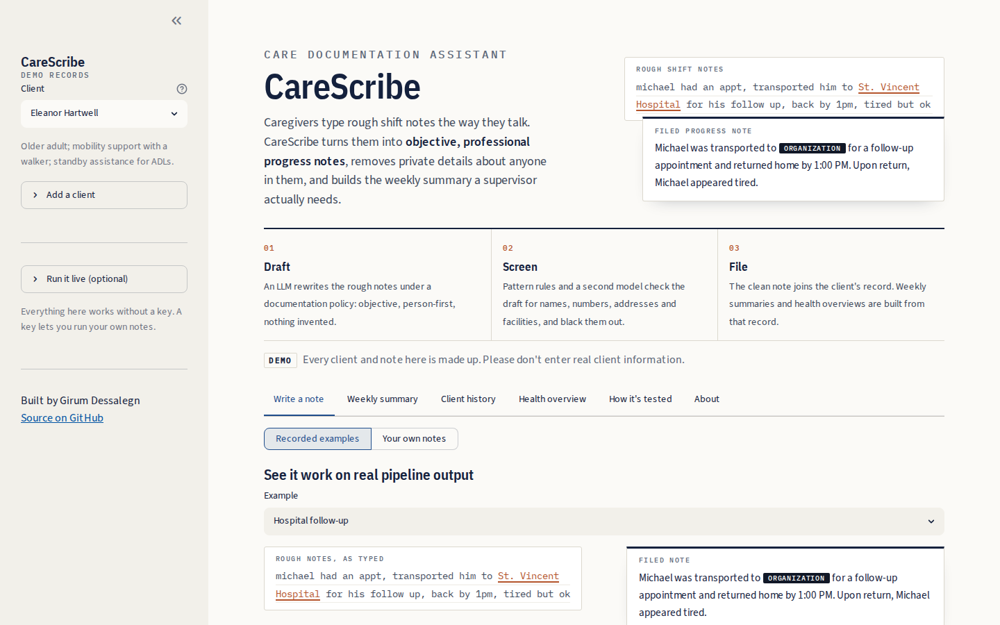
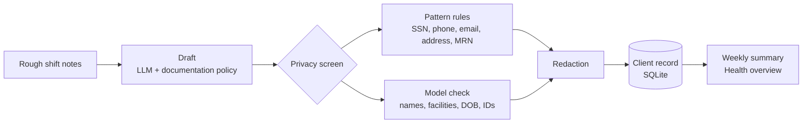

# CareScribe

[](https://github.com/Girumdess/care-note-assistant/actions/workflows/ci.yml)

**Caregivers write rough shift notes. CareScribe turns them into objective, professional progress notes, removes private details about anyone mentioned, and builds the weekly summary a supervisor needs.**

**[Try the live demo →](https://care-note-assist.streamlit.app)** No sign-up or API key needed. Every client and note in it is synthetic.



## What it does

| | |
|---|---|
| **Daily notes** | Rewrites rough notes ("helped john shower, he was kind of lazy about breakfast") into objective, person-first documentation. |
| **Privacy screen** | Checks every draft in two layers, pattern rules plus a second model, and blacks out names, phone numbers, emails, addresses, record numbers, facilities and dates of birth before the note is saved. |
| **Weekly summaries** | Keeps only incidents, changes from baseline and follow-ups. Routine care is left out. |
| **Health overviews** | Reads a client's whole record for active concerns, trends and things to watch. |

## How it works



- Drafting and summaries: Claude Sonnet 4.6
- Privacy check and quality grading: Claude Haiku 4.5
- Python, Streamlit, SQLite

## How it's tested

An evaluation harness (`evals/`) runs 18 synthetic shift notes through the full pipeline. Eleven have private details planted on purpose (phone numbers, an SSN, a home address, a medical record number, a date of birth, a hospital, and names of family, staff and other residents); the rest cover everyday documentation such as a fall, a medication refusal and judgmental wording.

- **0 of 14** planted details reached a filed note.
- **4.26 / 5** average note quality, graded by a separate model on objectivity, completeness, professional tone and not inventing facts.

It's a small synthetic set and a single run, so it shows the approach holds up on these cases rather than proving clinical accuracy. The full per-case results are in the app's *How it's tested* tab and in `reports/eval_results.json`.

Offline tests (`tests/`) cover the pattern rules, redaction, parsing, and a smoke test of every app tab. They run on every push, and pull requests also get screenshots of each tab.

## Run it locally

```bash
pip install -r requirements.txt
cp .env.example .env        # add your Anthropic API key to run your own notes
streamlit run app.py
```

Without a key, the recorded examples, client history, weekly summaries and health overviews all work. A key (about a cent per note) lets you write your own notes.

```bash
pip install pytest ruff && pytest -q && ruff check .   # tests and lint
PYTHONPATH=. python -m evals.run_evals                  # re-run the evaluation (needs a key)
```

## Privacy

This is a prototype on synthetic data, not a certified HIPAA-compliant system, and the hosted demo should never receive real client information. Each visitor to the demo works in their own copy of the records. Real-world use would also need a Business Associate Agreement with the model provider on HIPAA-eligible hosting, sign-in with role-based access and audit logging, and encryption at rest. The privacy screen reduces exposure; it isn't formal Safe Harbor de-identification.

## Author

Girum Dessalegn · [github.com/Girumdess](https://github.com/Girumdess)
